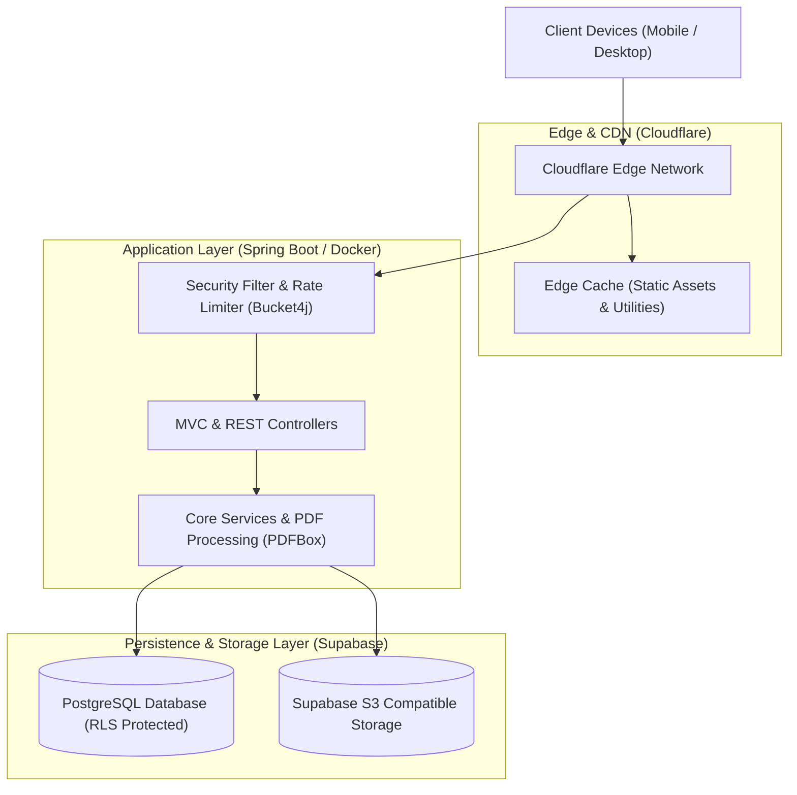

<div align="center">

# 🎓 UniDocs Platform
### Modern Academic Document Management & Student Study Ecosystem

[](https://github.com/ntainguyenit/Unidocs-Platform/actions/workflows/ci.yml)
[](https://openjdk.org/projects/jdk/21/)
[](https://spring.io/projects/spring-boot)
[](https://www.postgresql.org/)
[](https://supabase.com/)
[](https://tailwindcss.com/)
[](LICENSE)

**[Live Demonstration](https://unidocs-husc.pages.dev/)** • **[Report Bug](https://github.com/ntainguyenit/Unidocs-Platform/issues)** • **[Request Feature](https://github.com/ntainguyenit/Unidocs-Platform/issues)**

</div>

---

## 📖 Overview

**UniDocs Platform** is a production-grade, open-source academic document management system engineered to streamline academic resource discovery, exam preparation, and peer collaboration for university students. Built with **Spring Boot 3** on **Java 21 LTS**, it features high-throughput document streaming, multi-tier cloud storage, content moderation, and client-side utilities.

---

## 🏛️ System Architecture



---

## ✨ Key Features

- **📚 Hierarchical Academic Taxonomy:** Intuitive categorization organizing materials by Universities, Faculties, Courses, and Academic Semesters.
- **👁️ Inline Document & Exam Viewer:** Direct in-browser PDF rendering and image preview without forcing file downloads.
- **🖼️ Automated Thumbnail Synthesis:** Background extraction of the first page of PDF documents via **Apache PDFBox** for instant visual card previews.
- **🛡️ Steganographic Anti-Scraping Protection:** Integrated client-side anti-theft scripts embedding invisible zero-width watermarks into copied text, preventing automated bulk scraping.
- **⚡ Zero-Delay Client-Side Student Utilities:** 15+ interactive educational tools running with zero server latency (Stopwatch, Flashcards, Markdown Editor, GPA Calculator, QR Generator, Exam Simulation).
- **📦 Administrative Bulk ZIP Ingestion:** Asynchronous processing of bulk ZIP archives with automatic directory parsing and deduplication.
- **🔐 Row-Level Security (RLS) & Rate Limiting:** Enforced PostgreSQL RLS across all tables and token bucket rate-limiting (`Bucket4j`) guarding against DDoS and crawler attacks.

---

## 🛠️ Technology Stack

| Layer | Technologies |
| :--- | :--- |
| **Backend Core** | Java 21 LTS, Spring Boot 3.x, Spring Data JPA, Spring Security |
| **Database** | PostgreSQL 17 (Supabase Managed), Row-Level Security (RLS) |
| **Object Storage** | Supabase Storage (AWS S3-compatible protocol) |
| **Frontend & UI** | Thymeleaf, Tailwind CSS 3.4, Vanilla JavaScript (ES6+), Plus Jakarta Sans |
| **Document Processing** | Apache PDFBox, ImageIO |
| **Security & Protection** | Cloudflare Turnstile, Bucket4j, Steganographic Watermarking |
| **Container & CI/CD** | Docker Multi-Stage, GitHub Actions Workflow |

> 📖 *For an in-depth breakdown of dependencies, frameworks, and architecture decisions, see the [Technology Stack Specification](docs/TECHSTACK.md).*

---

## 🚀 Getting Started

### Prerequisites

Ensure you have the following installed on your local environment:
- **Java Development Kit (JDK) 21** or later
- **Maven 3.9+** (or use the included `./mvnw` wrapper)
- **Git**
- **Docker** *(optional, for containerized execution)*

### 1. Clone the Repository

```bash
git clone https://github.com/ntainguyenit/Unidocs-Platform.git
cd Unidocs-Platform
```

### 2. Environment Configuration

The application uses an optional `src/main/resources/application-secrets.properties` for production secrets, while gracefully falling back to an in-memory **H2 Database** for local development.

To configure local or cloud credentials, copy or create `src/main/resources/application-secrets.properties`:

```properties
# Supabase PostgreSQL (Optional - falls back to H2 if omitted)
DB_URL=jdbc:postgresql://<host>:5432/<dbname>
DB_USER=<username>
DB_PASSWORD=<password>

# Supabase S3 Object Storage
SUPABASE_S3_ENDPOINT=https://<project-ref>.storage.supabase.co/storage/v1/s3
SUPABASE_S3_ACCESS_KEY=<access-key>
SUPABASE_S3_SECRET_KEY=<secret-key>
SUPABASE_S3_BUCKET=documents
```

### 3. Run the Application

```bash
# Using Maven Wrapper (Windows)
.\mvnw.cmd spring-boot:run

# Using Maven Wrapper (macOS / Linux)
chmod +x ./mvnw
./mvnw spring-boot:run
```

Access the local server at: **`http://localhost:8080`**

### 4. Run Test Suite

```bash
./mvnw test
```

### 5. Run with Docker

```bash
# Build multi-stage Docker image
docker build -t unidocs:latest .

# Run container
docker run -p 8080:8080 unidocs:latest
```

---

## 📂 Project Structure

```text
unidocs/
├── .github/
│   └── workflows/
│       └── ci.yml               # Automated CI build & test pipeline
├── docs/                        # Architecture & technical specifications
│   └── TECHSTACK.md             # Detailed technology stack document
├── src/
│   ├── main/
│   │   ├── java/com/unidocs/
│   │   │   ├── aop/             # Aspect-oriented rate limiting & logging
│   │   │   ├── config/          # Security, Cache, and WebMVC configuration
│   │   │   ├── controller/      # REST API & Web MVC controllers
│   │   │   ├── domain/          # JPA database entities
│   │   │   ├── dto/             # Data Transfer Objects
│   │   │   ├── repository/      # Spring Data JPA repositories
│   │   │   ├── security/        # Auth filters, Turnstile verification
│   │   │   ├── service/         # Business services (Storage, Document, Audit)
│   │   │   └── util/            # PDF thumbnail generation & helpers
│   │   └── resources/
│   │       ├── static/          # JavaScript utilities, CSS, and brand assets
│   │       └── templates/       # Thymeleaf HTML views (User, Admin, Utilities)
│   └── test/                    # JUnit 5 & Mockito test suites
├── Dockerfile                   # Production multi-stage Dockerfile
├── LICENSE                      # MIT Open Source License
├── package.json                 # Tailwind CSS build scripts & dependencies
├── pom.xml                      # Maven project dependencies & plugins
└── tailwind.config.js           # Tailwind CSS configuration
```

---

## 🤝 Contribution & Standards

Contributions are welcome! Please follow these steps:

1. **Fork** the repository.
2. Create your feature branch (`git checkout -b feature/amazing-feature`).
3. Commit your changes adhering to [Conventional Commits](https://www.conventionalcommits.org/) (`git commit -m 'feat: add amazing feature'`).
4. Ensure all tests pass (`./mvnw test`).
5. Push to your branch (`git push origin feature/amazing-feature`).
6. Open a **Pull Request**.

---

## 📄 License

This project is licensed under the **MIT License** - see the [LICENSE](LICENSE) file for details.

---

<div align="center">
Developed with ❤️ by <a href="https://github.com/ntainguyenit">Tai Nguyen</a>
</div>
